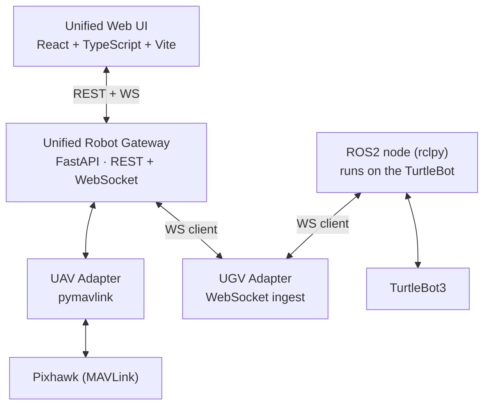

# Heterogeneous Aerial-Ground Supervisory System

A protocol-agnostic supervisory platform for heterogeneous UAV/UGV robot
teams: a Pixhawk-based drone (MAVLink) and a TurtleBot3 (ROS2) are
normalized into one common robot model, coordinated through a
safety-supervised leader/follower controller, and presented through a
single web UI with live telemetry, mission control, AI-assisted
supervision, and full experiment recording/replay.

This began as a flat collection of point-to-point scripts bridging one
drone to one TurtleBot (`docs/audit.md` documents that starting point in
full) and has been rebuilt into the architecture below, reusing the
scripts' working control math (GPS↔odom frame conversion, go-to-point
control law) rather than discarding it.

## Research Motivation

See [`docs/novelty.md`](docs/novelty.md) for the full framing. In short:
the contribution is the **architecture** — normalizing MAVLink and ROS2
telemetry into one semantic model, coordinating heterogeneous robots
through a shared coordinate frame, gating every command through one
safety layer regardless of protocol, and recording everything (telemetry,
coordination, events, AI recommendations) on one synchronized timeline —
not any single piece of it in isolation.

## System Architecture



Full architecture, data flow, and the reasoning behind each design
decision: [`docs/architecture.md`](docs/architecture.md).

## Key Contributions

1. **Common Robot Model** — one schema (`RobotState`) every adapter
   normalizes into; the UI never parses MAVLink or ROS2 messages.
   ([`docs/common_robot_model.md`](docs/common_robot_model.md))
2. **Centralized, tested coordinate transforms** — GPS↔ENU, NED↔ENU,
   TurtleBot odom→mission frame, all in one module with documented sign
   conventions. ([`docs/coordinate_frames.md`](docs/coordinate_frames.md))
3. **Dynamic leader/follower coordination** — either robot can lead;
   role switches are logged with before/after tracking error and
   stabilization time.
4. **One safety gate for every command**, regardless of which robot or
   protocol it targets. ([`docs/safety.md`](docs/safety.md))
5. **Non-actuating AI supervision** — structured recommendations only,
   validated against a whitelist, with zero code path to an actuator.
6. **Synchronized experiment recording, metrics, and replay.**
   ([`docs/experiments.md`](docs/experiments.md))

## Hardware

- Pixhawk-family flight controller with GPS (or indoor position source)
- TurtleBot3 (Burger or compatible differential-drive base) running ROS2
- A host machine for the gateway + UI (does not need to be on the robot)

## Software Stack

| Layer | Technology | Why |
|---|---|---|
| Drone comms | `pymavlink` | Standard, pure-Python MAVLink |
| Robot middleware | ROS2 / `rclpy` | Standard for TurtleBot3 |
| Gateway | FastAPI + WebSockets | Testable without a ROS2 install; see `docs/architecture.md` for the `rosbridge` tradeoff discussion |
| Frontend | React + TypeScript (strict) + Vite | |
| Map | Local ENU (SVG, no deps) + MapLibre GL JS (OSM tiles) | No proprietary Google Maps dependency |
| Charts | Recharts | React-native API, right-sized for this dashboard's chart complexity (see `docs/audit.md` decision log) |
| State | Zustand | Minimal, split by concern (robot/coordination/mission/event/connection) |
| Persistence | SQLite behind a repository interface | Simplest reliable option for a research prototype; swappable for Postgres later without touching call sites |
| LLM supervisor | Provider-agnostic interface: Mock / Disabled / OpenAI / Claude | |

## Repository Structure

```
backend/            FastAPI gateway (common model, adapters, safety,
                     coordination, mission, experiment recorder, supervisor)
ros_node/            ROS2 ament_python package — runs on the TurtleBot
ui/                  React/TS/Vite frontend
config/              robots.yaml, mission.yaml, system.yaml
docs/                architecture, common model, coordinate frames,
                     safety, experiments, novelty
experiments/         curated result sets by category
docker-compose.yml   simulation/demo deployment
scripts/             dev_backend.sh, dev_frontend.sh, run_tests.sh
```

Legacy scripts (`drone_to_turtlebot_bridge.py`, `mavlink_forwarder.py`,
`turtlebot_sender.py`, `pc_turtlebot_pixhawk_bridge.py`, `drone_llm*.py`,
`test_drone_data.py`) remain at the repo root — blockers fixed, kept for
reference/rollback — and are superseded by the architecture above; see
`docs/audit.md` for exactly what was reused vs. replaced.

## Installation

### Backend

```bash
cd backend
python -m venv .venv
.venv/Scripts/activate   # or: source .venv/bin/activate
pip install -r requirements.txt
```

Requires Python 3.9+. On Python <3.10, `eval_type_backport` (already in
`requirements.txt`) is required for FastAPI to evaluate `X | None` type
annotations at runtime — without it, the app fails to import with a
`TypeError` from pydantic. On 3.10+ this dependency is a no-op.

### Frontend

```bash
cd ui
npm install
```

### ROS2 (only needed on the TurtleBot's companion computer)

```bash
cd ros_node
colcon build --packages-select heterogeneous_robot_bridge
source install/setup.bash
```

Requires ROS2 (Humble/Iron) + `rclpy`, `nav_msgs`, `sensor_msgs`,
`geometry_msgs`, and the `websockets` Python package. This step was not
run as part of this repository's own verification — see
`docs/novelty.md`'s "Honest limitations" for why (no ROS2 install in the
authoring environment) and what was verified instead (the pure-math
`coordinate_transformer` import path, and `py_compile` syntax checks).

## Configuration

Everything deployment-specific lives in `config/*.yaml` + `.env` — see
[`.env.example`](.env.example). Never commit `.env`. Key files:

```yaml
# config/robots.yaml — the robot registry
robots:
  drone_01:
    type: UAV
    protocol: MAVLink
    connection: "udp:0.0.0.0:14550"   # or "COM10" / "/dev/ttyUSB0" + baud
  turtlebot_01:
    type: UGV
    protocol: ROS2
    namespace: "/turtlebot_01"
```

```yaml
# config/system.yaml — safety thresholds, gateway networking, LLM provider
safety:
  max_tracking_error_m: 3.0
  heartbeat_timeout_s: 2.0
supervisor:
  provider: "mock"   # mock | disabled | openai | claude
mode: "SIMULATION"    # SIMULATION | TEST | PHYSICAL
```

## Simulation Mode (no hardware required)

```bash
# Terminal 1
DEPLOYMENT_MODE=SIMULATION scripts/dev_backend.sh
# Terminal 2
scripts/dev_frontend.sh
```

Open http://localhost:5173. Connect both robots from the connection
screen — `MockDroneAdapter`/`MockTurtleBotAdapter` synthesize realistic
motion, battery drain, and (via `POST /api/robots/{id}/fault`) injected
latency, packet loss, GPS noise/loss, odometry freeze, and disconnects.
Fault injection is refused outright when `DEPLOYMENT_MODE=PHYSICAL` — see
`docs/safety.md`.

Or, for a one-command demo:

```bash
docker compose up
```

(This builds and runs the backend in `SIMULATION` mode and the frontend
behind nginx. Compose syntax was validated with `docker compose config`
in this environment; a full `docker compose up` build was not executed
here since no Docker daemon was running at authoring time — see the
troubleshooting note below if the build fails on your machine for an
unrelated reason.)

## Physical Robot Mode

```bash
# On the gateway host:
DEPLOYMENT_MODE=PHYSICAL scripts/dev_backend.sh
cd ui && npm run dev

# On the TurtleBot's companion computer:
ros2 launch heterogeneous_robot_bridge turtlebot_bridge.launch.py \
    robot_id:=turtlebot_01 \
    gateway_ws_url:=ws://<gateway-host>:8000/ws/ingest \
    heading_deg_from_north:=<compass bearing the robot's front faces at boot>
```

The drone needs no separate process — `DroneAdapter` connects directly
from the gateway using the `connection` string in `config/robots.yaml`
(UDP, TCP, or serial+baud).

## Running an Experiment

1. Connect both robots.
2. Choose leader/follower, leave "Record experiment" checked, click
   **START**.
3. Watch tracking error, separation, and the AI supervisor panel live.
4. **STOP** when done. Metrics are computed automatically.
5. View it on the **Experiments** page: metrics tiles, time-series
   charts, JSON/CSV export, and side-by-side comparison against another
   experiment.

Full procedure and metric definitions: [`docs/experiments.md`](docs/experiments.md).

## Replay Mode

**Replay** page → select a recorded experiment → scrub the timeline or
press play (0.5×–4×). Renders through the same map component the live
mission view uses, so a replay looks and behaves identically to a live
mission.

## Testing

```bash
scripts/run_tests.sh          # backend: 44 pytest tests
cd ui && npm run lint          # frontend: tsc --noEmit (strict mode)
cd ui && npm run build         # full production build
```

Covers: coordinate math (angle wraparound, GPS/NED/odom conversions,
quaternion→yaw), safety gating (every block reason, clamping, rate
limiting, emergency stop), the mission state machine (all legal/illegal
transitions), coordination computation (tracking error, separation,
role-switch logging, LOST-state command suppression), the LLM
recommendation validator (rejects out-of-range confidence and
actuator-level language in free text), and experiment metrics (RMSE,
percentiles, JSON/CSV export). All 44 backend tests and a full TypeScript
strict-mode build were verified in this environment; interactive
in-browser testing was not — no browser/screenshot tool is available
here, so click-through UI behavior is unconfirmed beyond what
type-checking, the production build, and live backend WebSocket/REST
verification (see `docs/audit.md` commit history) can guarantee.

## Safety

Read [`docs/safety.md`](docs/safety.md) before connecting to real
hardware. Summary: every command passes through one `SafetyManager` gate
(connection/heartbeat/staleness/rate/velocity checks); emergency stop is
a large, unmistakable, confirmation-guarded UI control that immediately
zero-commands every connected robot and blocks all further commands; the
LLM supervisor has no code path to an actuator, ever, and the system
functions identically with it disabled.

## Troubleshooting

- **`TypeError: unsupported operand type(s) for |: 'type' and 'NoneType'`**
  on backend startup: you're on Python <3.10 without
  `eval_type_backport` installed — `pip install -r requirements.txt`
  again (it's already listed there).
- **Port 8000/5173 already in use**: another instance is still running;
  on Windows, `Get-Process python|node | Stop-Process -Force` (adjust to
  target only your own processes).
- **TurtleBot never shows "connected"**: the gateway's `/ws/ingest`
  endpoint waits for the ROS2 node to dial *out* to it — check
  `gateway_ws_url` in the launch command matches the gateway's actual
  reachable address, and that `robot_id` matches an entry in
  `config/robots.yaml`.
- **Fault injection returns 403**: `DEPLOYMENT_MODE=PHYSICAL` disables it
  intentionally (`docs/safety.md`); use `SIMULATION` or `TEST`.

## Research Metrics

Automatically computed per experiment: tracking RMSE, mean/max/p95
tracking error, mean/max separation, mean/max latency, mission duration,
warning/critical event counts, role-switch count + mean stabilization
time, LLM recommendation count + mean LLM latency. Full definitions:
[`docs/experiments.md`](docs/experiments.md).

## Roadmap

- rosbag2/MCAP export (JSON export already contains everything needed;
  conversion is mechanical but unautomated — `docs/experiments.md`)
- Generated ROS2 `.msg`/`.srv` interface package (currently JSON-over-
  WebSocket with a documented, stable field contract — `docs/audit.md`)
- UI-side receive-timestamp instrumentation, to close the model→UI hop
  of the latency chain (`docs/novelty.md` "Honest limitations")
- API authentication for non-lab deployments (`docs/architecture.md`)
- Live `rclpy` integration test against a physical or simulated
  TurtleBot (not run in this environment — no ROS2 install available)

## License

Apache-2.0 (see `ros_node/heterogeneous_robot_bridge/package.xml`; add a
top-level `LICENSE` file if you want this to apply repository-wide).
