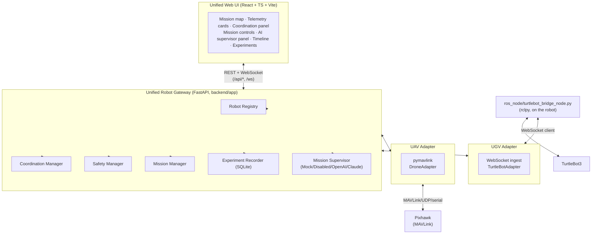

# System Architecture

## Overview

## Why a gateway, not `rosbridge_suite`

§5 of the design brief allows either `rosbridge_suite` + `roslibjs`, a
dedicated FastAPI/WebSocket backend, or a combination. This implementation
uses a FastAPI gateway as the *only* thing the browser talks to, for one
concrete, verifiable reason: the machine used to develop and test this
system has no ROS2 installation, so anything that depended on `rosbridge`
running locally could not be built or tested here (see the decision log in
[audit.md](audit.md)). The TurtleBot side keeps its ROS2 node
(`ros_node/heterogeneous_robot_bridge`) exactly where ROS2 already needs to
run — on the robot / its companion computer — and that node is a plain
`rclpy` script that dials *out* to the gateway over a WebSocket client
connection. The gateway never needs inbound network reachability to a
robot LAN, which is also a better security posture (§46) than a browser
being able to reach ROS2 topics directly.

The MAVLink side needed no such bridge: `pymavlink` is pure Python and
runs directly inside the gateway process as `DroneAdapter`.

## Components

| Component | File | Responsibility |
|---|---|---|
| Common Robot Model | `backend/app/models.py` | The one schema every adapter normalizes into (see [common_robot_model.md](common_robot_model.md)) |
| Coordinate Transformer | `backend/app/coordinate_transformer.py` | GPS↔ENU, NED↔ENU, TurtleBot odom→mission_map (see [coordinate_frames.md](coordinate_frames.md)) |
| Robot Registry | `backend/app/robot_registry.py` | Tracks every configured robot's adapter, capabilities, connection status, last state |
| Drone Adapter | `backend/app/adapters/drone_adapter.py` | Real MAVLink/pymavlink integration |
| TurtleBot Adapter | `backend/app/adapters/turtlebot_adapter.py` | WebSocket ingest side for the ROS2 node |
| Mock Adapters | `backend/app/adapters/mock_*.py` | Full simulation, no hardware required, with fault injection |
| Coordination Manager | `backend/app/coordination_manager.py` | Tracking error/separation/heading error, leader/follower role switching |
| Safety Manager | `backend/app/safety_manager.py` | The single gate every outbound command passes through (see [safety.md](safety.md)) |
| Mission Manager | `backend/app/mission_manager.py` | Explicit mission state machine |
| Experiment Recorder | `backend/app/experiment_recorder.py`, `db.py` | SQLite-backed recording + derived metrics (see [experiments.md](experiments.md)) |
| Mission Supervisor | `backend/app/supervisor/*` | LLM-backed (or mock/disabled) structured recommendations, with a deterministic output validator |
| Gateway app | `backend/app/main.py` | FastAPI assembly: REST routers, two WebSockets, control/supervisor background loops |
| ROS2 bridge node | `ros_node/heterogeneous_robot_bridge` | Runs on the TurtleBot; the only process that imports `rclpy` |
| Frontend | `ui/src` | React/TS/Vite; consumes only the common model, never protocol-specific messages |

## Data flow (steady state, mission RUNNING)

1. `DroneAdapter` (in-process) and the ROS2 node (out-of-process, over
   `/ws/ingest`) each push `RobotState` into `TelemetryStore` as it arrives
   — no polling on the hot path.
2. A background **control loop** (`main.py:_control_tick`, default 10 Hz)
   reads the latest leader/follower `RobotState`, asks
   `CoordinationManager.compute()` for the current `CoordinationState` and
   a candidate follower `RobotCommand`, passes that command through
   `SafetyManager.check_and_clamp()`, and — only if allowed — calls
   `adapter.send_command()`.
3. The same tick updates `MissionState` (degrade/recover on tracking
   loss), records telemetry+coordination to SQLite if an experiment is
   recording, and broadcasts `robot_state` / `coordination_state` /
   `mission_state` / `system_health` to every UI WebSocket client.
4. A separate, slower **supervisor loop** (default every 5s) builds a
   `SupervisorContext`, calls the active `MissionSupervisor`, validates
   the result, and broadcasts `supervisor_state`.
5. Any REST call that changes state (`connect`, `mission/start`, role
   switch, emergency stop, …) calls `GatewayState.emit_event()`, which
   both records and immediately broadcasts a `MissionEvent` on the
   `events` topic — the Timeline panel updates live, not just from the
   initial snapshot.

## Extensibility: adding a third robot type

Adding e.g. a quadruped requires, per §58:

1. A new `RobotAdapter` implementation (`connect`, `disconnect`,
   `get_state`, `send_command`) — see `backend/app/adapters/base.py`.
2. A `RobotType` value if `QUADRUPED`/`MANIPULATOR` (already reserved in
   `models.py`) doesn't cover it, plus whatever `RobotCapability` values
   are new.
3. An entry in `config/robots.yaml`.
4. Registration of the adapter type in `robots_api.py::_build_adapter`.

No frontend change is required: `RobotsPanel` renders whatever
`GET /api/robots` returns, and `RobotCard` already renders conditionally
on which fields are present (`gps`, `velocity`, `battery`), not on
`robot_type`.

## What is intentionally not built here

- **ROS2 `.msg`/`.srv` interface package.** Deferred — see the decision
  log in [audit.md](audit.md). The wire contract (JSON matching
  `models.py`'s field names) is stable and documented; generating a real
  `.msg` package for a from `RobotState` is mechanical follow-up work once
  this runs on an actual ROS2 host.
- **rosbag2/MCAP export.** The recorder's JSON export already contains
  every stream needed; see [experiments.md](experiments.md) for the
  documented (not yet automated) conversion path.
- **Authentication on the gateway API.** Per §46 this is a lab/research
  prototype; the gateway binds to configurable CORS origins and is meant
  to sit behind a private network, not be exposed publicly. Adding auth
  (e.g. an API key header checked in a FastAPI dependency) is a contained,
  well-scoped addition and is called out in the README roadmap.
